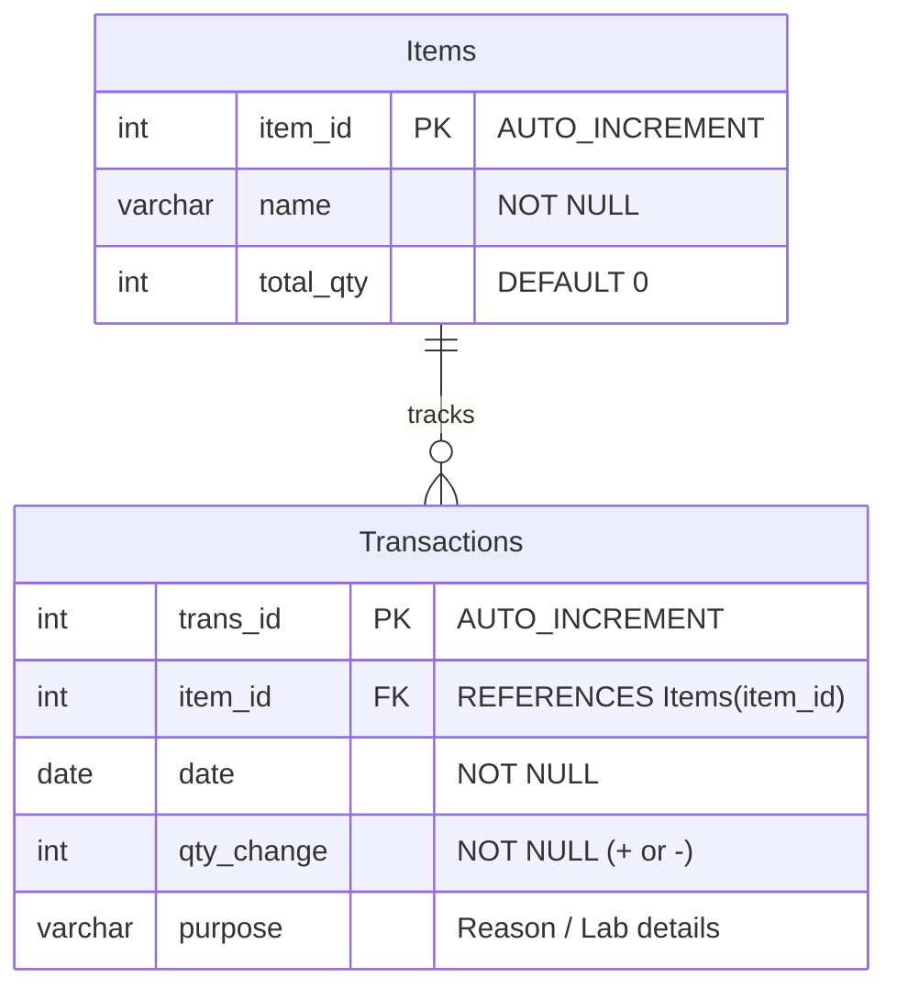

# 🔬 School Lab Inventory Manager

A procedural, desktop-based laboratory inventory management system built with Python (`tkinter` GUI) and MariaDB/MySQL (`mysql-connector-python`).

Developed specifically for the **CBSE Class 12 Computer Science** curriculum.

---

## 📌 Project Overview

The **School Lab Inventory Manager** allows school laboratory assistants and teachers to track lab apparatus, chemicals, and equipment. It records real-time stock levels, manages issuance and restocking of supplies, and automatically logs every transaction with calendar timestamps and purposes.

### Key Highlights
- **Strictly Procedural Architecture:** Built entirely using functions, loops, lists, and tuples—no classes or Object-Oriented Programming (OOP) to strictly comply with Class 12 CBSE curriculum guidelines.
- **Tkinter Desktop GUI:** Clean, intuitive, tabbed user interface (`ttk.Notebook`) featuring tabular data display using `ttk.Treeview` with built-in vertical and mouse wheel scrolling.
- **Relational Database Backend:** Powered by local MySQL / MariaDB via `mysql-connector-python` using parameterized queries (`%s`) to prevent SQL Injection attacks.
- **Atomic Operations:** Transaction logging and stock quantity adjustments are executed and committed together atomically.

---

## 🚀 Features

| Feature | Description |
| :--- | :--- |
| **Add New Item** | Register a new lab item with a starting stock quantity. |
| **Issue Item** | Deducts stock quantity and logs the event as a negative transaction record (`qty_change < 0`). |
| **Restock Item** | Adds stock quantity and logs the event as a positive transaction record (`qty_change > 0`). |
| **Live Inventory Table** | Interactive spreadsheet-like view of all lab items with real-time refresh on every change. |
| **Low Stock Alert** | User-defined threshold filter showing items that require urgent reordering. |
| **Transaction History** | Audit log tracking every issue/restock action, timestamped and linked via SQL `JOIN`. |

---

## 🗄️ Database Schema (`LabInventory`)

The database consists of two normalized tables linked by a Foreign Key constraint with `ON DELETE CASCADE`:



---

## 📂 Project Structure

```text
Class-Project/
├── main.py              # Main Python script (Tkinter GUI + MySQL backend)
├── setup.sql            # SQL script to create database and tables
├── grant_access.sql     # Helper script to configure user privileges
├── REVISION_NOTES.txt   # Line-by-line viva revision guide & flashcards
├── .gitignore           # Excludes virtual environments and sensitive files
└── README.md            # Project documentation
```

---

## ⚙️ Prerequisites & Installation

### 1. System Requirements
- **Python 3.8+**
- **MariaDB** or **MySQL Server**
- **Tk graphical library** (if running on Linux):
  ```bash
  # Arch Linux
  sudo pacman -S tk

  # Ubuntu / Debian
  sudo apt install python3-tk
  ```

### 2. Database Setup
Initialize the database using MariaDB or MySQL:
```bash
# Run the database creation script
sudo mariadb < setup.sql

# Grant privileges to your user (if using unix_socket auth)
sudo mariadb < grant_access.sql
```

### 3. Python Environment & Dependencies
Create and activate a virtual environment, then install the MySQL connector driver:
```bash
# Create virtual environment
python3 -m venv venv

# Activate virtual environment
source venv/bin/activate    # On Linux/macOS
# .\venv\Scripts\activate   # On Windows

# Install the official MySQL connector
pip install mysql-connector-python
```

---

## 🖥️ Running the Application

With the database running and virtual environment activated, launch the application:

```bash
python main.py
```

---

## 📖 Viva & Practical Exam Preparation

A comprehensive, line-by-line mechanical breakdown of how `mysql-connector` executes CRUD operations and how Tkinter button clicks communicate with the database is available in [`REVISION_NOTES.txt`](REVISION_NOTES.txt).

Topics covered include:
- The 4 core lines of database connectivity (`connect`, `cursor`, `close`).
- `%s` parameterized queries vs. SQL injection.
- Atomicity and `conn.commit()`.
- Difference between `fetchone()` and `fetchall()`.
- Inner working of Tkinter event loop, `lambda`, and `ttk.Treeview`.
- 20 high-frequency Viva flashcard Q&As.

---

## 📜 License
This project is prepared for educational and academic submission purposes under the CBSE Class 12 Computer Science curriculum.