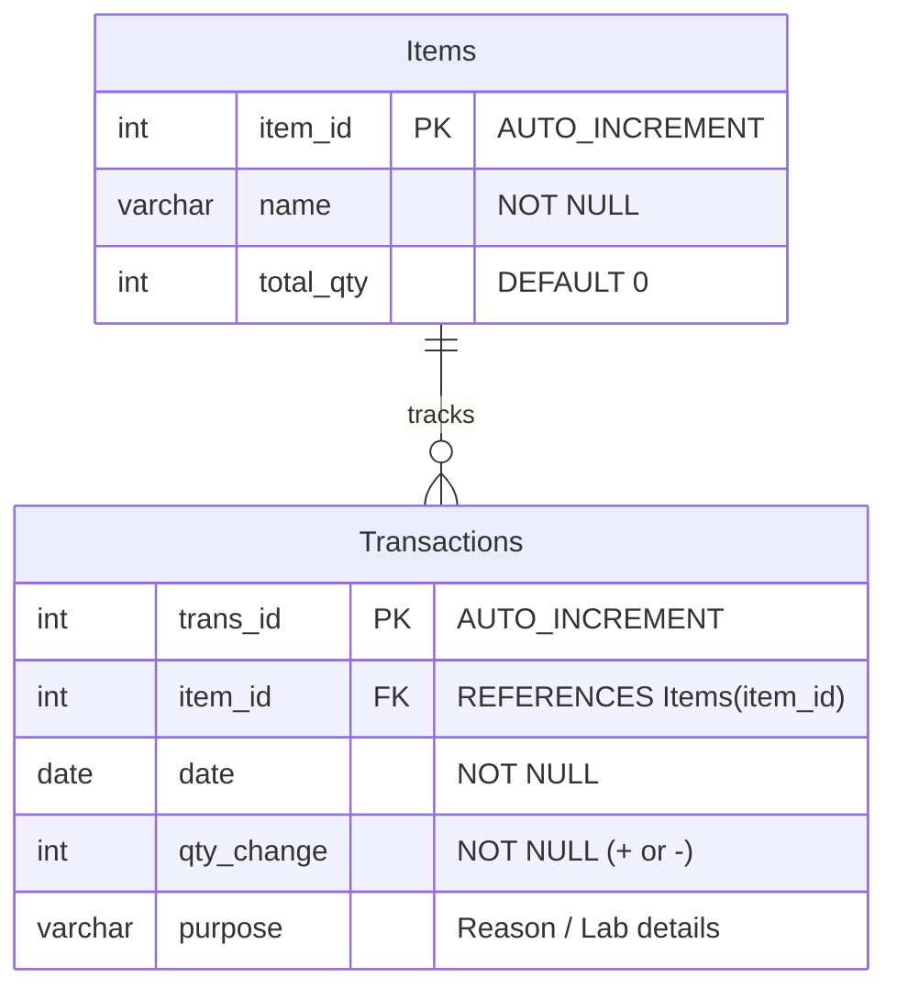

# 🔬 School Lab Inventory Manager

A procedural, cross-platform laboratory inventory management system built with **Python** and **MySQL / MariaDB** (`mysql-connector-python`). Developed specifically for the **CBSE Class 12 Computer Science** curriculum.

Provides **BOTH** an unbroken continuous-loop terminal menu interface (`terminal_app.py`) and a modern desktop GUI (`gui_app.py`) powered by `tkinter` and `ttk.Treeview`.

---

## ⚠️ Why Does `python terminal_app.py` Fail Without Setup?

**Short answer:** `mysql-connector-python` is not part of Python's standard library. It must be installed manually inside a **virtual environment (venv)** before the scripts can run.

On **Arch Linux / Archcraft**, the system Python is "externally managed" — you cannot `pip install` to it directly. You **must** create a venv and install the package inside it.

**The fix is simple — use the provided run scripts (easiest) or activate the venv manually.**

---

## ⚡ Quickest Way to Run (Linux — Archcraft / Arch)

Open a terminal inside the project folder and run:

```bash
# Terminal (text menu) version:
./run_terminal.sh

# Desktop GUI version:
./run_gui.sh
```

> If you get "Permission denied", run once: `chmod +x run_terminal.sh run_gui.sh`

These scripts **automatically** create the venv and install `mysql-connector-python` if missing, then launch the app. Nothing else needed.

---

## ⚡ Quickest Way to Run (Windows — School Lab / Home)

Double-click `run_terminal.bat` **or** open Command Prompt in the folder and run:

```cmd
run_terminal.bat
```

For the GUI:
```cmd
run_gui.bat
```

These scripts auto-create the venv and install the driver, then launch the app.

---

## 🧰 Manual Setup (If You Prefer)

### Linux / Archcraft (Home PC)

**Step 1 — Start MariaDB:**
```bash
sudo systemctl start mariadb
```

**Step 2 — Create the virtual environment and install the driver:**
```bash
python3 -m venv venv
source venv/bin/activate
pip install mysql-connector-python
```

**Step 3 — Run the app (venv must be active):**
```bash
# Terminal version:
python terminal_app.py

# GUI version:
python gui_app.py
```

> Every time you open a new terminal, re-activate the venv first:
> ```bash
> source venv/bin/activate
> ```

---

### Windows — School Lab / Home PC

**Step 1 — Ensure MySQL / XAMPP is running.** Open MySQL Workbench, XAMPP Control Panel, or MySQL Service in Windows Services.

**Step 2 — Open `db_config.py` in Notepad and set your password (if any):**
```python
DB_CONFIG = {
    "host": "localhost",
    "user": "root",
    "password": ""   # ← Change this if your MySQL has a password
}
```

**Step 3 — Open Command Prompt in the project folder:**
```cmd
python -m venv venv
venv\Scripts\activate
pip install mysql-connector-python
```

**Step 4 — Run the app:**
```cmd
python terminal_app.py
python gui_app.py
```

---

## 🗄️ Database — Zero Manual Setup Required

Both apps call `initialize_database()` on startup. It **automatically**:
- Creates `LabInventory` database if it doesn't exist
- Creates `Items` and `Transactions` tables if they don't exist
- Uses `CREATE DATABASE IF NOT EXISTS` and `CREATE TABLE IF NOT EXISTS`

You **do not need to run `setup.sql` manually.** The app handles everything.

---

## 📂 Workspace Structure

```text
Class-Project/
├── db_config.py         # DB credentials + get_connection() + initialize_database()
├── terminal_app.py      # Continuous while True: loop terminal menu
├── gui_app.py           # Procedural tkinter + ttk.Treeview desktop GUI
├── main.py              # Interactive launcher (choose GUI or Terminal)
│
├── run_terminal.sh      # Linux: auto-venv + run terminal_app.py
├── run_gui.sh           # Linux: auto-venv + run gui_app.py
├── run_terminal.bat     # Windows: auto-venv + run terminal_app.py
├── run_gui.bat          # Windows: auto-venv + run gui_app.py
│
├── requirements.txt     # Lists: mysql-connector-python
├── setup.sql            # Reference SQL schema (not needed to run manually)
├── grant_access.sql     # Reference SQL for Linux socket user permissions
├── REVISION_NOTES.txt   # Line-by-line Viva guide + 25 flashcard Q&As
└── README.md            # This file
```

---

## 🗄️ Database Schema (`LabInventory`)

Two normalized tables linked by a Foreign Key with `ON DELETE CASCADE`:



---

## 🖥️ Feature Summary

| Feature | Terminal (`terminal_app.py`) | GUI (`gui_app.py`) |
| :--- | :---: | :---: |
| Add New Lab Item | ✅ | ✅ |
| Issue Item (deduct stock) | ✅ | ✅ |
| Restock Item (add stock) | ✅ | ✅ |
| View Full Inventory | ✅ | ✅ (Treeview) |
| Low Stock Alert (threshold filter) | ✅ | ✅ |
| Transaction Audit Log | ✅ | ✅ (Treeview) |
| Input validation (no crash on letters) | ✅ | ✅ |
| Auto-creates database on startup | ✅ | ✅ |
| Cross-platform (Linux & Windows) | ✅ | ✅ |

---

## 📌 Architecture Compliance (CBSE Class 12)

This project is **100% procedural**:
- Uses only `def` functions, `while` loops, `if/elif/else`, `try/except`, `list`, `tuple`
- **Zero classes**, **zero OOP**, **zero inheritance**
- Strictly compliant with CBSE Class 12 Computer Science (Subject Code 083) guidelines

---

## 📖 Viva & Practical Exam Prep

Refer to [`REVISION_NOTES.txt`](REVISION_NOTES.txt) for a comprehensive viva guide covering:
- Why `venv` is required and what `ModuleNotFoundError` means
- How `db_config.py` auto-initializes the database
- The `while True:` loop in `terminal_app.py` and `try/except ValueError` for input safety
- How tkinter button clicks trigger SQL queries via `lambda:` and `command=`
- Atomicity, `fetchone()` vs `fetchall()`, `%s` vs SQL Injection
- **25 high-frequency Viva questions with model answers**

---

## 📜 Academic Declaration

Developed for CBSE Class 12 Computer Science (083) practical examination and project submission.